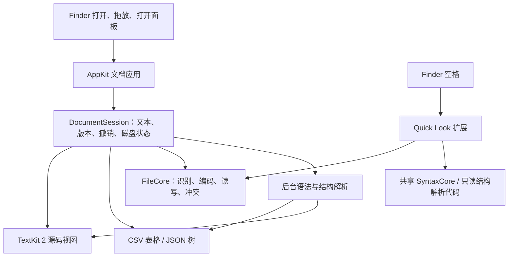

# 技术方案：原生文件编辑器

日期：2026-10-26。状态：小型 P0 已实现并编译，16 项自动测试通过；真实窗口和引擎性能尚待验收。产品范围见[产品定义](product-spec.zh-CN.md)，验收方法见[验证计划](validation-roadmap.zh-CN.md)，已测结果见[原型验证记录](prototype-validation.zh-CN.md)。下文架构主要描述完整 V1，P0 的实施边界如下。

**0. P0 实施边界与固定约束**

P0 使用 Swift/AppKit、系统文本组件和系统文件 API，构建不声明远程包依赖。当前已实现打开/保存/另存、多文件 tab、独立 dirty/undo、手动 Reload、窗口激活与保存前的磁盘变更核验，以及 Python/Java/JavaScript/TypeScript/JSON/JSONC/Shell 的简单本地着色。暂不引入 tree-sitter、CSV/JSON 结构视图、Quick Look、持续 watcher、日志 tail 或恢复服务；后文相关能力保留为 V1 设计，不作为原型前置工程。

实际 P0 通过手工 AppKit 窗口与 `EditorSession` 管理文档，使用 `NSTextView(usingTextLayoutManager: true)` 和独立 `UndoManager`，尚未采用 `NSDocument`。下表中的 `NSDocument`、Xcode extension targets 与模块拆分是 V1 规划，不能视为当前实现。文件读写上限为 10 MiB；本地扫描着色上限为 200 KiB 或 20,000 行，超限进入纯文本。

每个 tab 持有自己的文档状态，切换不重新读取磁盘或丢弃选区、滚动位置与撤销栈。同一路径重复打开应定位到已有 tab，避免出现两个互不知情的可写副本。保存冲突和关闭提示作用于对应文档，不能受当前选中 tab 变化影响。

Reload 的语义是从磁盘重新读取文件：先完成读取与解码，再替换编辑器；失败不动原文和 dirty 状态。有本地修改时提供取消、放弃后重载、另存副本后重载三种选择；副本保存失败或取消时不继续重载。完成重载后更新磁盘基线、清空 dirty 和旧 undo，并将选区限制到新文本范围，尽量恢复原滚动位置。不能通过撤销悄然恢复到磁盘被外部修改之前的旧内容。窗口激活检查与保存前核验是 P0 的最低实现，不将它宣传为持续监听。

全部功能在断网状态下可用，不接账号、遥测、自动更新或在线解析；必要语法和资源随包提供。未来功能仍遵守此要求，不把下载依赖变成首次使用步骤。开发环境的首次依赖获取及发布者向 Apple 提交签名/公证材料与应用运行是不同环节；当前 P0 本身不需获取第三方依赖，签名公证也不是用户使用功能时的服务依赖。

优先系统框架、系统字体和少量本地资源，避免捆绑浏览器、编译器、语言运行时及重复框架。P0 arm64 Release `.app` 目标 **≤15 MiB**；当前实测文件总大小 242,093 bytes（236.42 KiB）、磁盘占用 244 KiB，动态链接均为系统库。构建目录、符号文件、测试语料与安装压缩包另计，当前结果不能外推到完整 V1。增加 grammar 前记录增量体积，不能以在线下载绕开预算。

**1. 推荐技术栈与决策依据**

目标是让常见文件快速进入可读、可编辑状态。新产品直接组合系统组件和成熟解析库，核心复杂度放在文件可靠性、编辑体验与多视图一致性上。

| 层 | 建议选择 | 理由与实施边界 |
| --- | --- | --- |
| 应用语言/构建 | Swift 6、Xcode app/extension targets、Swift Package Manager | P0 无远程依赖；V1 引入依赖时锁定版本并提交 Package.resolved |
| 文档与窗口 | AppKit、NSDocument/NSDocumentController | 接入文档生命周期、菜单、最近文件、窗口；保存与恢复策略仍需明确定义 |
| 文本编辑 | NSTextView + TextKit 2，先做原型 | 使用系统输入、选择、排版和辅助功能基础；代码特性需要补齐 |
| 外围界面 | AppKit 为主，SwiftUI 可用于设置 | 避免把全文作为 SwiftUI 状态反复绑定和复制 |
| 语法解析 | V1：tree-sitter + 官方 swift-tree-sitter | P0 先用系统能力做简单着色；V1 按语言打包经过验证的 grammar/query，离线解析 |
| CSV 视图 | NSTableView + 保留原文范围的 CSV 扫描器 | 虚拟化行，按需解码字段；单元格修改转成局部文本编辑 |
| JSON 视图 | NSOutlineView + 带 token 范围的语法树 | 树用于导航、检索和定位源码；V1 在源码中编辑 |
| Finder 预览 | Quick Look preview extension | 空格查看代码/文本及受控的 CSV/JSON 预览；与主应用共享解析代码 |
| 文件访问 | Foundation、NSDocument 文件协调、文件监听 | 保存、权限、编码、冲突与恢复归一个服务层负责 |

AppKit 的系统文本栈适合先验证用户最看重的轻量与原生交互，但这并不证明其性能必然优于其他引擎。Apple 对 TextKit 2 的视口布局和国际文字支持有明确说明；产品仍需实现行号、当前行、缩进、注释、括号匹配及高亮等功能。[Apple TextKit 2](https://developer.apple.com/videos/play/wwdc2022/10090/)

| 引擎候选 | 当前核查结论 | 本项目决策 |
| --- | --- | --- |
| NSTextView / TextKit 2 | 系统文本栈，现成 macOS 文本交互；多选接口不等于完整多光标，折叠也需另做 | 首选原型；V1 不把多光标/折叠列为前置条件 |
| Scintilla Cocoa | 已有 Cocoa 后端，具备较完整代码编辑接口，需 Swift/Objective-C++ 适配 | 备选；首选在硬门槛上失败后再验证 |
| STTextView | TextKit 2 上的自定义视图；当前采用 GPLv3/商业双授权 | 不作为默认依赖；先明确授权与维护成本 |
| CodeEditTextView / SourceEditor | 自定义代码文本布局，MIT；SourceEditor 当前 README 明示尚未生产就绪 | 可研究实现，不直接作为已验证核心 |

来源：[NSTextView 多选约束](https://developer.apple.com/documentation/appkit/nstextview/selectedranges)、[Scintilla 文档](https://www.scintilla.org/ScintillaDoc.html)、[STTextView README](https://github.com/krzyzanowskim/STTextView/blob/main/README.md) 与 [LICENSE](https://github.com/krzyzanowskim/STTextView/blob/main/LICENSE.md)、[CodeEditTextView README](https://github.com/CodeEditApp/CodeEditTextView/blob/main/README.md)、[CodeEditSourceEditor README](https://github.com/CodeEditApp/CodeEditSourceEditor/blob/main/README.md)。这些是文档核查结果，不是本项目的运行验证。

**2. 架构与模块边界**

Quick Look 与主 App 共享模块代码，分别读取文件并持有自己的只读快照；它们不会跨进程共享一个可写文档对象。

建议 V1 扩展时按 `App/`、`Packages/DocumentCore/`、`Packages/FileCore/`、`Packages/SyntaxCore/`、`Packages/StructuredViews/`、`Extensions/QuickLook/`、`Tests/Fixtures/` 划分；P0 保持紧凑目录，不提前生成全部模块。

首版不自建通用文本排版引擎、rope 或插件框架。`EditorSurface` 仅封装装载文档、选区、范围修改、装饰和通知这些必要接口；避免为尚未选择的所有引擎设计大型抽象层。

**3. 一份文本、多个视图、一条撤销链**

`DocumentSession` 是每个打开文档的逻辑所有者，持有唯一可写文本存储、递增 revision、一个 UndoManager、编码/BOM/换行信息、磁盘身份与恢复状态。原始文件字节与后台快照可以作为不可变输入存在，不能成为第二份独立可编辑状态。

V1 首选设计用 `NSTextStorage` 作为 `NSTextContentStorage` 的 backing，具体接入方式由文本组件验证确定。所有可写操作在主线程统一进入编辑事务；文本视图输入与 CSV 单元格修改都推进同一 revision。结构解析结果只描述文本，不反向覆盖整份文本。

结构编辑请求可表达为 `TextEdit(expectedRevision, utf16Range, replacement)`。先校验当前 revision，再执行编辑协议、注册一次撤销、更新 dirty 状态。多范围修改从后往前应用并组成一个撤销组。不能一边让 NSTextView 注册 undo、一边重复注册同一变更；也不能认为直接调用 storage.replaceCharacters 就已正确接入输入法和用户编辑流程。[NSTextContentStorage](https://developer.apple.com/documentation/appkit/nstextcontentstorage)、[shouldChangeText](https://developer.apple.com/documentation/appkit/nstextview/shouldchangetext(in:replacementstring:))

内部编辑坐标统一为 UTF-16 范围，磁盘字节偏移单独建映射，用户看到的行列与可见字形位置再单独计算。官方 swift-tree-sitter 默认提供 UTF-16 兼容入口；`Node.byteRange` 与 `Node.range` 含义不同，不能互换，也不能拿 Swift String.count 当作 NSRange 长度。[SwiftTreeSitter 范围转换](https://github.com/tree-sitter/swift-tree-sitter/blob/main/README.md)

输入法 marked text 期间不得通过全文重设或结构刷新替换编辑器内容。异步解析可以暂缓，提交后按真实编辑范围恢复；主题/高亮装饰不得进入用户文本撤销链。

**4. 语法功能与后台任务**

V1 第一批验证 Python、Java、JavaScript/TypeScript、Swift、C/C++、Go、Rust、Shell、JSON、YAML、TOML、XML/HTML/CSS、Markdown、SQL 中的常用 grammar。这个列表是拟支持范围；只有 grammar、highlight query 和回归样例通过后，才标记为正式支持。未知类型照常按纯文本编辑，可手动切换语言。P0 简单着色应设置文件大小与工作量上限，超限保留纯文本编辑，不把着色结果作为结构编辑依据。

V1 提供高亮、行号、跳行、括号匹配、缩进/取消缩进、注释及字面查找替换。语法高亮不等于类型诊断、跨项目跳转或语义补全；LSP 作为后续可选模块。JSON 的结构解析错误可以直接定位，其他语言不把 tree-sitter 的错误节点宣传为编译器诊断。[tree-sitter 官方介绍](https://tree-sitter.github.io/tree-sitter/)

每个文档的解析工作由串行 actor/队列持有 parser/tree；捕获不可变版本化输入，后台计算，主线程接收结果前检查 revision。取消旧任务、限制积压、限制树节点和查询工作量。可优先绘制可见范围的高亮，但不能据此认为完整语法解析也天然有界。

文件先显示文本，再补高亮和结构视图；打字事件不能同步跑整份文件解析。正常文件使用增量更新，首次加载/严重语法改变允许有预算的全量重建。大文件入口独立限额，不能为了高亮把整个大文件复制多份。

V1 不默认引入无资源上限的任意正则搜索。后续增加正则时应选择能控制匹配资源的实现或隔离执行；把任务放后台、调用 Task.cancel 都不等于能中断底层匹配。

**5. CSV 专用视图**

V1 覆盖逗号和制表符分隔、可选表头、引号转义与字段内换行；其他方言提供源码编辑和后续扩展入口。内容嗅探只能建议分隔符/表头，不把猜测当作事实。CSV 字段可包含换行，解析不能按 split("\n") 或 split(",") 实现。[RFC 4180](https://www.rfc-editor.org/rfc/rfc4180)

采用保留原文范围的状态机扫描器，记录行/字段范围、分隔符、引号状态和 revision。表格按可见行解码；限制同时物化的单元格和列数。行虚拟化本身不能解决巨大列数或完整索引的内存问题，超过结构预算时显示清楚的降级状态。

所有值默认都是字符串：`00123`、长账号、日期样式和 `=SUM(...)` 均保留词面。表头开关、列宽和只读筛选只是视图状态，不写回文件。首版不做公式、自动类型转换、持久排序、增删列和任意整表粘贴。

修改单元格时只替换对应字段的源文范围。根据新内容决定是否加引号、对双引号转义，未改字段及分隔符保持原样；一个修改在源码中立刻可见，Cmd-Z 一次恢复原始文本。空字段、缺失字段和末尾空列要区分。记录数或引号状态变化可能要求重新扫描后续内容，应可取消并拒绝基于过期范围的下一次写入。

解析失败时源码仍可编辑；表格标明不可用/过期并暂停结构修改，直到新版本解析完成。禁止把整表解码成对象后重新导出来完成普通保存。

**6. JSON 专用视图**

V1 为源码编辑 + 可折叠树 + 键/值检索 + 点击节点定位源文。树按需物化子节点，设置深度、节点数和解析预算。修改在源码区完成，避免在首版同时设计全部树形编辑语义。

节点保留原始 token/range 和成员出现顺序，数字以原始词面保存，不先转 Double；同名键的每次出现都保留并提示。不能使用 Dictionary/JSONEncoder 往返作为编辑存储，否则可能改变重复成员、数字、空白或顺序。[RFC 8259](https://www.rfc-editor.org/rfc/rfc8259)

可复制 JSON Pointer，但重复键不能靠 Pointer 唯一定位，内部节点身份使用 revision + token 范围；向用户说明歧义。[RFC 6901](https://www.rfc-editor.org/rfc/rfc6901)

严格 JSON 校验与 tree-sitter 的容错解析分层：后者允许展示未完成内容，不代表文件有效。JSONC/JSON5 首版保留源码编辑，对树视图支持分别标注，不按严格 JSON 自动修复。格式化作为用户明确触发的独立动作，普通打开、切换视图和保存不自动格式化。

**7. 文件识别、保存、冲突和恢复**

识别结合 UTType、扩展名/文件名和有界内容检查。编码顺序为 BOM、严格 UTF-8、受控历史编码候选/用户选择；先排除 UTF-16 后再考虑 NUL 等二进制信号。无法无损解码时保留原字节并提供编码选择或只读状态，不把替换字符写回原文件。

V1 首批覆盖 UTF-8（含 BOM）、UTF-16 LE/BE，并验证中文常见 GBK/GB18030 的转换库/系统支持与往返行为。保存保留编码、BOM、尾部换行与混合换行；可显式转换，但不能因浏览或改一个单元格而全文件归一化。P0 对已支持编码验证 TextKit 输入、粘贴和保存的往返行为，未实现的编码明确拒绝或提示，不静默损坏文件。

默认 Cmd-S 写回原文件，恢复快照写应用数据目录；自动恢复与自动写回是两种不同功能。依托 NSDocument 的安全保存路径实现临时写入/替换、错误反馈和 dirty 状态，不仅使用一个 Data.write(.atomic) 就宣称可靠。权限、ACL/xattr、符号链接/硬链接、只读卷和网络位置需要确定策略并测试。[NSDocument](https://developer.apple.com/documentation/appkit/nsdocument)、[自动保存语义](https://developer.apple.com/library/archive/documentation/DataManagement/Conceptual/DocBasedAppProgrammingGuideForOSX/StandardBehaviors/StandardBehaviors.html)

V1 文件协调结合 watcher、窗口重新激活检查和保存前磁盘版本检查；P0 先实现后两项和手动 Reload。NSFilePresenter 不保证收到绕过 NSFileCoordinator 的底层写入通知。原子替换后重新绑定文件身份；文件未修改时可重载，已修改时保留当前内容并提示处理，不静默覆盖外部版本。P0 使用第 0 节的取消/放弃后重载/另存副本后重载流程，比较视图等后续补充。[NSFilePresenter](https://developer.apple.com/documentation/foundation/nsfilepresenter)

恢复快照写入 revision、源文件身份/版本和校验信息，以独立草稿恢复；不能在重启时自动覆盖更新后的原文件。恢复周期和最大可丢失窗口在界面与测试中明确，不宣称崩溃前最后一次按键必然持久化。

**8. Finder、Quick Look 与分发**

通过 CFBundleDocumentTypes/LSItemContentTypes 声明编辑角色，使用已有 UTType 或 imported type 注册外部格式，提供“打开方式”。默认关联由用户按代码/配置/数据等组主动设置；系统可能要求同意。未知类型、无扩展名文件和隐藏配置文件同时由打开面板、拖放和“按文本打开”覆盖。[类型声明](https://developer.apple.com/documentation/uniformtypeidentifiers/defining-file-and-data-types-for-your-app)、[设置默认应用](https://developer.apple.com/documentation/appkit/nsworkspace/setdefaultapplication(at:toopen:completion:))

Quick Look 采用现代 preview extension，复用 FileCore/SyntaxCore 的只读能力。扩展使用独立的小字节/行数/解析预算，先显示可读内容，允许截断并明确提示；不读取整个巨型文件、不长时间持有文件描述符。需要实测扩展发现、多个提供者冲突、支持类型和系统缓存，不承诺任意未知扩展名都能被接管。Apple 未给这里统一可承诺的固定内存/超时阈值。[QLPreviewingController](https://developer.apple.com/documentation/quicklookui/qlpreviewingcontroller/preparepreviewoffile(at:completionhandler:))

主应用按 sandbox-friendly 接口设计，用户选择文件/目录后保存 security-scoped bookmarks；脚本保存、文件类型关联设置和未来 CLI 能力要作为沙箱兼容原型。直接分发的 Sandbox 可选，Mac App Store 需要，正式模式在 P0 结果后确定。首期建议 Developer ID 签名、公证的直接分发，Quick Look 扩展一起验证签名与加载。[沙箱文件访问](https://developer.apple.com/documentation/security/accessing-files-from-the-macos-app-sandbox)、[Apple 分发准备](https://developer.apple.com/documentation/xcode/preparing-your-app-for-distribution)

**9. 依赖和后续扩展**

P0 不引入第三方代码。V1 引入 tree-sitter 核心、Swift binding、每个 grammar 和 query 时，都需记录来源、固定版本、许可证和体积增量；Swift binding 当前为 BSD-3-Clause。版本兼容以选定的 runtime/grammar ABI 和构建结果为准，不跟随浮动 main 发布，随应用交付全部必要资源。[Swift binding Package.swift](https://github.com/tree-sitter/swift-tree-sitter/blob/main/Package.swift)、[许可证](https://github.com/tree-sitter/swift-tree-sitter/blob/main/LICENSE)

PDF、图片、Markdown 渲染、目录搜索、CLI 和可选 LSP 留在后续阶段，按实际使用频率加入。所有功能继续离线工作；如果将来采用 LSP，语言服务必须在本地执行，必要依赖须有明确离线交付方式，并按文档/语言懒启动及设置资源预算。V1 的启动路径不加载项目索引、编译器、终端或常驻后台服务。
